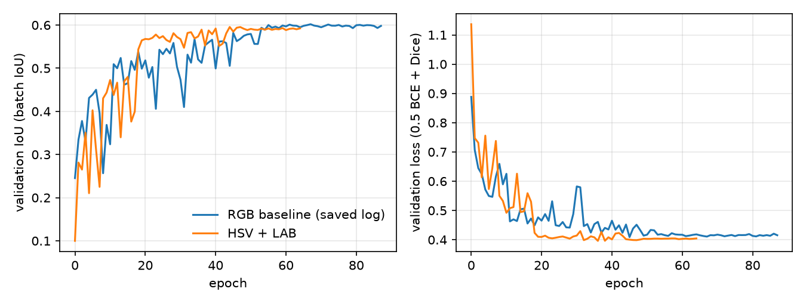

# Multi-colour-space channel selection for chronic wound segmentation

This repository contains the code behind my first-author paper, *Multi-Colour Space Channel Selection for Improved Chronic Wound Segmentation* (IEEE ISBI 2024) [TODO: paper link or DOI]. I trained a U-Net on the DFUC2022 diabetic foot ulcer dataset with extra colour channels (HSV, CIELAB, a luminance channel) merged into the input tensor, alongside or instead of RGB. On the DFUC2022 test set the HSV+LAB input scored 0.4207 IoU against 0.4020 for the RGB baseline (paper Table 3), from single training runs.

## The problem

Wound photographs vary in lighting, skin tone and wound appearance, and a network given only RGB has to learn any colour representation it needs from 1,600 training images. My question was whether handing the network a few extra channels from other colour spaces helps, without running a separate network branch per colour space (the multi-input colour U-Nets cited in the paper do that). Only the first convolution changes: the input has 4 or 6 channels instead of 3.

```
BGR image (cv2.imread)
   |-- rgb       3 ch   B G R                                  baseline
   |-- rgb_y     4 ch   B G R + luminance^k                    "RGB + Y" in the paper
   |-- rgb_a     4 ch   B G R + log(CIELAB a)                  "RGB + A"
   '-- hsv_lab   6 ch   H S V + L a b (no RGB)                 "HSV + LAB"
        |
        v   divide by 255  ->  U-Net (32-512 filters, 4 poolings, sigmoid in loss and metric)  ->  mask
```

[TODO: add Fig. 1 from the paper (the tensor-merging diagram); I have not copied it into the repository.]

## Results

All numbers below are from the paper (Tables 2 and 3). I transcribed them into [results/paper_reported.csv](results/paper_reported.csv), and [scripts/make_results_table.py](scripts/make_results_table.py) formats them. Each row is **one training run (one seed)**, so there is no standard deviation to report.

**Validation, DFUC2022 (paper Table 2).** Best epoch by validation IoU. The same 400 images picked the epoch and give the score, so these are optimistic.

| Colour space | Epoch | Val IoU | Val Dice | Val loss |
|---|---|---|---|---|
| RGB | 45 | 0.5950 | 0.7341 | 0.4034 |
| RGB + Y | 48 | 0.5966 | 0.7354 | 0.3987 |
| RGB + A | 34 | 0.5827 | 0.7239 | 0.4016 |
| HSV + LAB | 44 | 0.5957 | 0.7331 | 0.4017 |

**Test, DFUC2022 (paper Table 3).** 2,000 images. FNE and FPE are false-negative and false-positive error rates [TODO: add the definition used]. The last two columns are differences from the RGB row, computed by the script.

| Colour space | FNE | FPE | IoU | Dice | IoU vs RGB | Dice vs RGB |
|---|---|---|---|---|---|---|
| RGB | 0.4313 | 0.3947 | 0.4020 | 0.5181 | +0.0000 | +0.0000 |
| RGB + Y | 0.4038 | 0.3912 | 0.4176 | 0.5347 | +0.0156 | +0.0166 |
| RGB + A | 0.4481 | 0.3418 | 0.4121 | 0.5364 | +0.0101 | +0.0183 |
| HSV + LAB | 0.4107 | 0.3838 | 0.4207 | 0.5364 | +0.0187 | +0.0183 |

**Change in IoU relative to RGB on all four test sets (paper Table 3).** The first row is the RGB IoU; the others are differences from it.

|  | DFUC2022 test | CWDB | AZH | FUSC |
|---|---|---|---|---|
| RGB (IoU) | 0.4020 | 0.6224 | 0.5208 | 0.4855 |
| RGB + Y | +0.0156 | +0.0326 | -0.0088 | +0.0391 |
| RGB + A | +0.0101 | +0.0138 | +0.0023 | -0.0225 |
| HSV + LAB | +0.0187 | +0.0474 | -0.0205 | +0.0127 |

What the numbers do and do not show:

- The headline gain, +0.0187 IoU and +0.0183 Dice, is HSV+LAB against RGB on the DFUC2022 test set. HSV+LAB had the best test IoU of the four models there. The model with the best validation score, RGB+Y, gives +0.0156 IoU and +0.0166 Dice on the same test set.
- The gains do not hold on every external test set: HSV+LAB is below RGB on AZH (-0.0205 IoU), and RGB+A is below RGB on FUSC (-0.0225).
- On validation the differences are small (largest: RGB+Y, +0.0016 IoU over the RGB row).
- By wound size (paper Table 4), every model scores about 0.20 IoU or less on small wounds (under 10% of the image), against 0.45-0.47 on medium and 0.55-0.61 on large ones. Small wounds are where all models, with or without extra channels, do worst.

**What files in this repository back these numbers.** The saved training logs in [results/runs/](results/runs/) reproduce the HSV+LAB validation row exactly (run `hsv_lab_single_tensor`). They do not reproduce the other three rows. The saved baseline log (`baseline_bs8`) reached 0.6019 IoU and 0.7394 Dice at epoch 67, not the 0.5950 and 0.7341 in the table, and I have no logs for the RGB+Y and RGB+A rows. The test results (Tables 3 and 4) have no saved output here: the models were evaluated on a high-performance machine, predictions were not kept, and the evaluation code and test masks are not in this repository. They are quoted from the paper, not regenerated.

Validation curves from the saved logs, RGB baseline and HSV+LAB:



### Qualitative examples

[TODO: qualitative figure with good cases and failure cases. No predictions were saved, so this needs the original checkpoints (not in this repository) run on test images. The paper's Fig. 2 shows one case where the HSV+LAB model segmented a small, partly visible wound that the RGB model missed.] Given the wound-size results above I expect failures to concentrate on small wounds, but I have not checked individual images.

## Usage

**Reported results.** The reported results come from the original runs on a high-performance GPU machine. I refactored the code afterwards for readability and did not re-run the experiments. The refactored code was checked with unit tests, a test that compares each colour transform with the original dataset classes on random images, and a smoke test on a tiny synthetic dataset. It has not been re-run on DFUC2022.

**Dataset.** DFUC2022 cannot be redistributed and is not included. [TODO: how to obtain it, for example the challenge page and the access conditions.] Put it in this layout (masks are PNG, images are JPEG, same file stem):

```
data/dfuc2022/train/images/*.jpg   data/dfuc2022/train/masks/*.png     (1,600 images)
data/dfuc2022/val/images/*.jpg     data/dfuc2022/val/masks/*.png       (400 images)
```

**Environment.**

```bash
pip install -r requirements.txt && pip install -e .     # or: docker build -t dfuc-colour . && docker run --rm dfuc-colour
pytest                                                  # unit tests and synthetic smoke test (CPU, about 15 s)
```

`requirements.txt` pins the versions the tests ran with. The original experiments used older versions (Python 3.7, PyTorch 1.12.0), listed in comments in that file.

**Train and evaluate.**

```bash
python scripts/train.py    --config configs/hsv_lab.yaml --data_root data     # also baseline_rgb, rgb_y, rgb_a
python scripts/evaluate.py --run runs/hsv_lab --data_root data --split val
```

`evaluate.py` reports the same batch IoU and soft Dice as training. It is not the protocol behind the paper's test tables.

**Regenerate the results tables and figure from the saved outputs.**

```bash
python scripts/make_results_table.py     # writes results/results_table.md and results/runs_summary.csv
python scripts/make_figures.py           # writes results/figures/val_curves.png
```

The configs record the settings of the original runs: batch size 8, Adam at 1e-3 with weight decay 1e-4, reduce-on-plateau with patience 6, early stopping after 20 epochs, loss 0.5 x BCE + Dice, torch seed 42. Two settings are marked `[TODO]` because I cannot recover them: the luminance exponent behind the paper's RGB+Y row, and whether the paper's RGB+A run used the log transform that the current source has.

## Repository structure

```
src/dfuc_colour/   colourspaces.py (channel merging), dataset.py, models.py (U-Net), losses.py,
                   metrics.py (IoU, Dice), training.py (loop and config handling)
configs/           one YAML per experiment
scripts/           train.py, evaluate.py, make_results_table.py, make_figures.py
tests/             colour transforms, metrics, model shapes, synthetic smoke test
results/           saved configs and logs of the 76 original runs, numbers transcribed from the paper,
                   generated tables and figure
archive/           original working-directory code that the package does not use (kept for reference)
```

## Citation

```bibtex
@inproceedings{mcbride2024multicolour,
  title     = {Multi-Colour Space Channel Selection for Improved Chronic Wound Segmentation},
  author    = {McBride, Christian and Cassidy, Bill and Kendrick, Connah and Reeves, Neil D. and Pappachan, Joseph M. and Yap, Moi Hoon},
  booktitle = {IEEE International Symposium on Biomedical Imaging (ISBI)},
  year      = {2024},
  note      = {[TODO: pages and DOI]}
}
```
